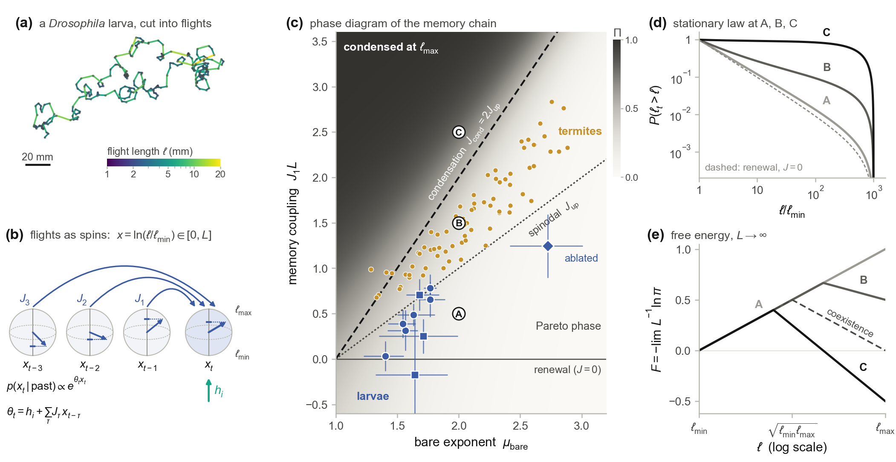

# Dynamic Maximum-Entropy Inference for Individual and Collective Lévy Walks

[](https://www.python.org/downloads/)
[](https://scipy.org/)
[](#verification--testing)
[](LICENSE)

> **Reference Implementation & Reproducibility Suite**  
> Accompanying the manuscript:  
> *"Memory in Lévy walks from the dynamic-entropy formalism"*  
> **Adriano Barra, Andrea Ladiana** — *Sapienza Università di Roma & INFN, Sezione di Roma*

---

## Overview

Heavy-tailed movement steps ($\ell \sim \ell^{-\mu}$) across biology and ecology are routinely analyzed under the assumption that successive flights are independent. This repository implements a rigorous **dynamic maximum-entropy (Maximum Caliber)** framework for finite-order Markov chains of log-step lengths $x_t = \ln(\ell_t / \ell_{\min}) \in [0, L]$ (with dynamic range $L = \ln\ell_{\max} - \ln\ell_{\min}$) and turning directions $\mathbf{s}_t \in \mathbb{S}^{d-1}$, together with its extension to interacting multi-agent groups.

<p align="center">
  
</p>

### Key Theoretical & Empirical Results

#### 1. Causal Dynamic-Entropy Factorization & Exact Heisenberg Response

Conditioning on the $K$-step history, the dynamic-entropy transition kernel on $[0, L]$ takes the exponential-family form

$$
P(x_t \mid x_{t-1}, \dots, x_{t-K}) = \frac{1}{Z(\theta_t, \beta)} \exp\left(\theta_t x_t - \beta x_t^2\right), \qquad \theta_t = h_i + \sum_{\tau=1}^K J_\tau (x_{t-\tau} - c).
$$

In the pure power-law regime ($\beta = 0$), the bare field maps to the Pareto exponent via $h = 1 - \mu_{\mathrm{bare}}$, the log-partition function is closed-form, and the conditional mean step is governed by the classical **Heisenberg-spin Langevin function** $\mathcal{L}(u) = \coth u - 1/u$:

$$
\langle x_t \rangle_{\theta_t} = \frac{L}{2}\left[1 + \mathcal{L}\left(\frac{\theta_t L}{2}\right)\right], \qquad \mathrm{Var}(x_t)_{\theta_t} = \frac{L^2}{4\sinh^2(\theta_t L / 2)} - \frac{1}{\theta_t^2}.
$$

#### 2. First-Order Condensation Transition & Exponent Dressing ($K = 1$)

The one-step chain is exactly solvable via a self-adjoint Hilbert–Schmidt transfer operator, yielding the explicit stationary marginal $\pi(x) \propto e^{h x} Z(h + J_1 x)$ and a **self-dual coexistence line** $h + \frac{1}{2} J_1 L = 0$, equivalently expressed through the dimensionless control parameter

$$
\Phi \equiv \frac{J_1 L}{\mu_{\mathrm{bare}} - 1} = 2.
$$

Across $\Phi = 2$, the walker undergoes a first-order transition between a small-step Lévy phase ($\Phi < 2$) and a boundary-condensed ballistic phase ($\Phi > 2$) with $O(1)$ bimodal coexistence at $\Phi = 2$. Even below criticality ($\Phi < 2$), positive memory $J_1 > 0$ **dresses the apparent i.i.d. tail exponent** downward, $\hat\mu_{\mathrm{iid}} \approx \mu_{\mathrm{bare}} - J_1 \langle x \rangle_{\pi} < \mu_{\mathrm{bare}}$, biasing standard memoryless Clauset–Shalizi–Newman (CSN) fits toward the ballistic limit.

#### 3. Collective Self + Social Decomposition & Mean-Field Criticality

For $N$ simultaneous walkers with unit fixed effects $h_i$ and optional per-frame common-drive fixed effects $g_t$, the effective field decomposes into individual persistence and delayed neighbor coupling:

$$
\theta_{i,t} = h_i + g_t + \sum_{\tau=1}^{K_s} a_\tau x_{i,t-\tau} + \sum_{\tau=1}^{K_c} J_\tau \bar{x}_{\mathcal{N}_i(t),t-\tau}, \qquad \mathbf{H}_{i,t} = \mathbf{h}_i + \mathbf{g}_t + \sum_{\tau=1}^{K_s} a_\tau \mathbf{s}_{i,t-\tau} + \sum_{\tau=1}^{K_c} J_\tau \bar{\mathbf{s}}_{\mathcal{N}_i(t),t-\tau}.
$$

In the memoryless global limit ($a = 0$), the exact mean-field critical coupling is $J_c(0) = 12 / L^2$; self memory $a > 0$ amplifies single-agent susceptibility $\chi_{\mathrm{self}}(a) > L^2/12$ and lowers the collective ordering threshold $J_c(a) = 1 / \chi_{\mathrm{self}}(a) < 12/L^2$.

#### 4. Five Empirical Benchmarks

- **Individual walkers**: *Drosophila melanogaster* larvae ($10$ neural genotypes, $755$ tracks, $7.4 \times 10^4$ flights), *Syntermes dirus* termites ($76$ tracks, $3.9 \times 10^4$ flights), and murine $\mathrm{CD8}^+$ T cells in *Toxoplasma*-infected brain tissue ($996$ tracks).
- **Collective groups**: wild olive baboons (*Papio anubis*, $N = 25$ GPS collars at $1\ \mathrm{Hz}$) and homing pigeons (*Columba livia*, $29$ releases across $3$ flocks at $5\ \mathrm{Hz}$).

---

## Repository Structure

### Core Library (`code/`)

| Module | Description |
| :--- | :--- |
| [`code/maxent_levy.py`](code/maxent_levy.py) | Exact causal Maximum-Caliber solver (`powerlaw` $\beta=0$ closed forms and `lognormal` $\beta \neq 0$ 64-node Gauss–Legendre quadrature), damped Newton MLE, fixed-effects block concentration (`fit_fe`), sandwich covariance, AIC/BIC/TIC selection, and exact $K=1$ stationary marginal. |
| [`code/joint.py`](code/joint.py) | Joint log-step $x_t$ and turning-angle $\Delta\varphi_t$ causal Maximum-Entropy model with exact Bessel $I_0, I_1$ log-partition and Newton solver, plus step-turn coupling $\gamma x_t \cos\Delta\varphi_t$. |
| [`code/collective.py`](code/collective.py) | Multi-agent log-step MaxEnt inference ($\mathrm{self}\ a_\tau + \mathrm{social}\ J_\tau$) for global and $k$-nearest-neighbor local fields, with two-way unit $h_i$ and time-frame $g_t$ fixed-effects concentration (`fit_collective`) and the Cavagna–Giardina single-lag estimator (`pre_pipeline`). |
| [`code/collective_dir.py`](code/collective_dir.py) | Multi-agent directional von Mises–Fisher ($d=2, 3$) Maximum-Entropy inference with two-way alternating block Newton solver (`fit_dir_fe`) for individual bias $\mathbf{h}_i$ and frame drift $\mathbf{g}_t$. |
| [`code/meanfield.py`](code/meanfield.py) | Exact transfer-operator spectrum, self-memory susceptibility $\chi_{\mathrm{self}}(a)$, critical social coupling $J_c(a)$, and exact multi-lag NVAR linear response for the $K=1$ collective speed model. |
| [`code/simulate.py`](code/simulate.py) | Synthetic trajectory generators for causal chains, static-heterogeneity mixtures, smoothly drifting environmental fields, reflective arena truncation, and fractional Brownian motion (Davies–Harte). |
| [`code/simulate_collective.py`](code/simulate_collective.py) | Collective simulators: coupled log-step Langevin chains (`speed_chain`), Vicsek kinematics with MaxEnt speed dynamics (`speed_vicsek`), and common environmental drive controls (`common_drive`). |
| [`code/baselines.py`](code/baselines.py) | Classical memoryless baselines: Clauset–Shalizi–Newman MLE + KS goodness-of-fit, Edwards bounded power-law / exponential MLE, log-normal MLE, and multi-lag ACF / Ljung–Box / mutual-information tests. |
| [`code/realdata.py`](code/realdata.py) | 2D/3D trajectory turning-point segmentation (`segment_2d`, `segment_nd`) and non-stationarity controls (`fit_block_fe`, cyclic time-shift surrogates). |
| [`code/realgroups.py`](code/realgroups.py) | Full empirical group analysis pipeline (joint speed + direction AIC/BIC order selection, $k$-NN sensitivity, time-FE common-drive absorption, and circular time-shift surrogates). |

### Experiment Suites & Test Suite (`code/`)

| Script | Description |
| :--- | :--- |
| [`code/exp_synthetic.py`](code/exp_synthetic.py) | Synthetic validation benchmarks `S1`–`S6` (parameter recovery, CSN exponent bias, static heterogeneity vs. memory, finite-arena truncation, family misspecification, and fBm). |
| [`code/exp_collective.py`](code/exp_collective.py) | Collective synthetic benchmarks `C1`–`C7` (mean-field susceptibility, self-memory critical shift, multi-lag NVAR vs. single-lag bias, delayed $k$-NN recovery, common-drive absorption, and joint speed–direction decouple). |
| [`code/exp_drosophila.py`](code/exp_drosophila.py) | *Drosophila* larva analysis across all 10 genotypes: order selection, block-field controls, segmentation robustness, and empirical condensation index $\Phi$. |
| [`code/exp_termites.py`](code/exp_termites.py) | *Syntermes dirus* termite trail analysis: radial core-vs-wall partitioning, block fixed effects, and step–angle factorization. |
| [`code/exp_tcells.py`](code/exp_tcells.py) | 3D murine $\mathrm{CD8}^+$ T-cell motility analysis (control vs. anti-CXCL10 blockade) with pooled permutation tests. |
| [`code/exp_realgroups.py`](code/exp_realgroups.py) | Collective self + social inference on GPS baboon troops and homing pigeon flocks. |
| [`code/exp_collective_real.py`](code/exp_collective_real.py) | Negative-control collective tests on solo *Drosophila* plates and dense 3D T-cell recordings (plus ROCK-inhibited tracks). |
| [`code/test_core.py`](code/test_core.py), [`code/test_collective.py`](code/test_collective.py), [`code/test_dir_fe.py`](code/test_dir_fe.py) | Automated `pytest` verification suite covering closed-form partitions, finite-difference gradients/Hessians, exact $K=1$ stationary densities, collective fixed effects, and mean-field criticality. |

### Figure Pipeline & Precomputed Outputs (`paper/` & `results/`)

| Path | Description |
| :--- | :--- |
| [`paper/scripts/make_figs.py`](paper/scripts/make_figs.py) | Master figure-generation entrypoint producing all 9 publication figures (`fig1`–`fig4` and `figA1`–`figA5`) in `paper/figs/` from the precomputed JSONs in `results/` and `paper/data/`. |
| [`paper/scripts/compute.py`](paper/scripts/compute.py) | Precomputes auxiliary numerical caches in `paper/data/` (exact $K=1$ phase-diagram grids, stationary marginals, and finite-size scaling curves). |
| [`paper/figs/`](paper/figs/) | Generated publication figures (`fig1_overview` through `fig4_groups` and `figA1_theory` through `figA5_collective`) in `.pdf` and `.png` formats. |
| [`results/`](results/) | Complete precomputed JSON outputs for synthetic experiments (`synthetic_S1`–`S6`, `collective_C1`–`C7`) and empirical benchmarks (`drosophila_*`, `termites*`, `tcells*`, `realgroups_*`, `collective_real_*`). |

---

## Installation

Clone the repository and install the package in editable mode (Python $\ge 3.10$):

```bash
git clone https://github.com/andrea-ladiana/levy-walks-maxent.git
cd levy-walks-maxent

# Standard installation
pip install -e .

# With testing dependencies
pip install -e ".[dev]"
```

---

## Usage Examples

### 1. Single-Walker Causal MaxEnt Inference & Model Selection

```python
import numpy as np
from maxent_levy import simulate_model, scan_orders, select, stationary_marginal_K1

rng = np.random.default_rng(42)
L = np.log(1e3)                      # dynamic range L = ln(l_max / l_min)
h_true = -0.8                        # bare exponent mu_bare = 1 - h = 1.8
J_true = [0.25, 0.10]                # 2-step causal memory couplings

# Simulate a single trajectory of N = 15,000 flights
trajs = simulate_model(h=h_true, J=J_true, L=L, c=0.0, n_steps=15_000, rng=rng)

# Fit causal hierarchy K = 0 .. 6 and select optimal order via BIC
fits = scan_orders(trajs, L=L, K_max=6, family="powerlaw", c=0.0)
K_star, best_fit = select(fits, criterion="bic")

print(f"Selected order K* = {K_star}")
print(f"Estimated h  = {best_fit.h:+.4f} ± {best_fit.se[0]:.4f} (true {h_true:+.4f})")
print(f"Estimated J  = {np.round(best_fit.J, 4)} ± {np.round(best_fit.se[1:], 4)}")
```

### 2. Exact $K = 1$ Stationary Distribution & Condensation Index $\Phi$

```python
import numpy as np
from maxent_levy import stationary_marginal_K1

L = np.log(100.0)
mu_bare = 1.8
h = 1.0 - mu_bare
J1 = 0.35                            # dimensionless index Phi = J1 * L / (mu_bare - 1) ~ 2.01

x_grid, pi_x = stationary_marginal_K1(h=h, J1=J1, L=L, c=0.0)
mean_x = np.trapezoid(x_grid * pi_x, x_grid)
phi = J1 * L / (mu_bare - 1.0)
print(f"Condensation parameter Phi = {phi:.3f} (critical threshold Phi_c = 2.0)")
print(f"Exact stationary <x> = {mean_x:.3f} (midpoint L/2 = {L/2:.3f})")
```

### 3. Collective Self + Social Inference with Unit & Time Fixed Effects

```python
import numpy as np
import collective as co
from simulate_collective import speed_vicsek, group_from_positions

rng = np.random.default_rng(7)
sim = speed_vicsek(
    N=40, T=600, rng=rng, L=np.log(100.0),
    a=[0.25, 0.10],                  # 2-lag self memory
    Jloc=[0.0, 0.0, 0.35],           # delayed local social coupling at lag tau* = 3
    h=rng.uniform(-1.2, -0.4, 40),   # heterogeneous individual bare fields
)
group, L = group_from_positions(sim)

# Build k-NN local design and fit with unit fixed effects h_i
D = co.build_design([group], Ks_max=3, Kc_max=5, mode="local")
fit = co.fit_collective(D, Ks=2, Kc=5, family="powerlaw", unit_fe=True, time_fe=False, L=L)

print("Self memory a_tau :", np.round(fit.a, 3), "±", np.round(fit.se_a, 3))
print("Social coupling J :", np.round(fit.J, 3), "±", np.round(fit.se_J, 3))
```

---

## Reproducing Paper Results & Figures

### Regenerating All Manuscript Figures (No External Data Needed)

All precomputed JSON tables (`results/*.json`) and numerical grids (`paper/data/*`) are included in the repository. To regenerate all 9 figures (`fig1_overview` through `fig4_groups` and `figA1_theory` through `figA5_collective` in both `.pdf` and `.png` formats):

```bash
python paper/scripts/make_figs.py
```

To recompute a single figure (e.g. `fig1` or `fig4`):

```bash
python paper/scripts/make_figs.py fig1 fig4
```

### Running the Synthetic Benchmark Suites

```bash
# Single-walker synthetic benchmarks S1 - S6
python code/exp_synthetic.py all

# Collective synthetic benchmarks C1 - C7
python code/exp_collective.py all

# Auxiliary phase-diagram & finite-size grids for Fig. 1, Fig. 2, and Fig. A2
python paper/scripts/compute.py all
```

### Running the Empirical Benchmark Pipelines

If you have downloaded the raw empirical trajectory datasets (Sims et al. 2019 *Drosophila* larvae, Cristaldo et al. 2015 *Syntermes dirus* termites, Harris et al. 2012 $\mathrm{CD8}^+$ T cells, Crofoot et al. 2015 olive baboons, and Nagy et al. 2010 homing pigeons), point `LEVY_DATA_DIR` to the dataset root directory and run:

```bash
export LEVY_DATA_DIR=/path/to/Levy-walks   # PowerShell: $env:LEVY_DATA_DIR="C:\path\to\Levy-walks"

python code/exp_drosophila.py main
python code/exp_drosophila.py block
python code/exp_drosophila.py robust
python code/exp_drosophila.py phase

python code/exp_termites.py main
python code/exp_termites.py block
python code/exp_termites.py wall

python code/exp_tcells.py

python code/exp_realgroups.py baboons10
python code/exp_realgroups.py baboons30
python code/exp_realgroups.py pigeons

python code/exp_collective_real.py larvae
python code/exp_collective_real.py tcells
python code/exp_collective_real.py tcells_rockout
```

---

## Verification & Testing

The repository includes an automated `pytest` suite verifying:
1. Machine-precision agreement ($< 10^{-11}$) between analytical power-law partition functions/moments, Heisenberg-spin Langevin responses, and 96-node Gauss–Legendre quadrature across stiff and near-zero fields.
2. Exact inverse-CDF sampling moments and analytical vs. finite-difference gradients and Hessians ($< 10^{-7}$ relative error) for both `powerlaw` ($\beta = 0$) and `lognormal` ($\beta \neq 0$) families.
3. Parameter recovery, BIC/AIC/TIC order selection, and agreement between the exact $K=1$ Hilbert–Schmidt stationary marginal and Monte Carlo trajectories.
4. Equivalence between single-walker and collective solvers, delayed $k$-NN social coupling recovery ($\tau^* = 3$), exact mean-field susceptibility $\chi_{\mathrm{self}}(a)$ and critical coupling $J_c(a)$, and two-way unit/time fixed-effects concentration for directional von Mises chains.

Run the full test suite from the repository root:

```bash
pytest
```

---

## Citation

If you use this code or build upon the dynamic maximum-entropy framework for Lévy walks in your research, please cite:

```bibtex
@article{barra2026memory,
  title   = {Memory in {L}{\'e}vy walks from the dynamic-entropy formalism},
  author  = {Barra, Adriano and Ladiana, Andrea},
  journal = {Physical Review E (submitted)},
  year    = {2026}
}
```

---

## License

This project is licensed under the **MIT License** — see the [LICENSE](LICENSE) file for details.
